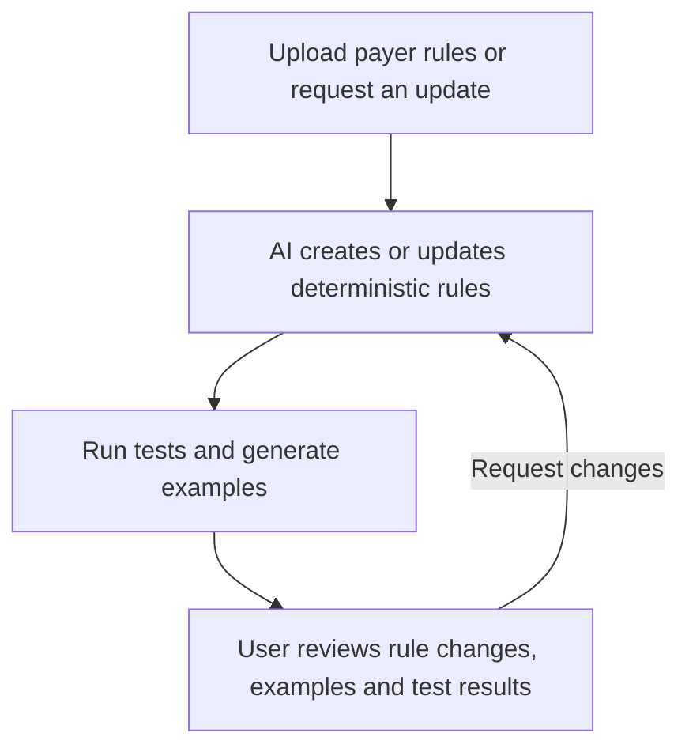
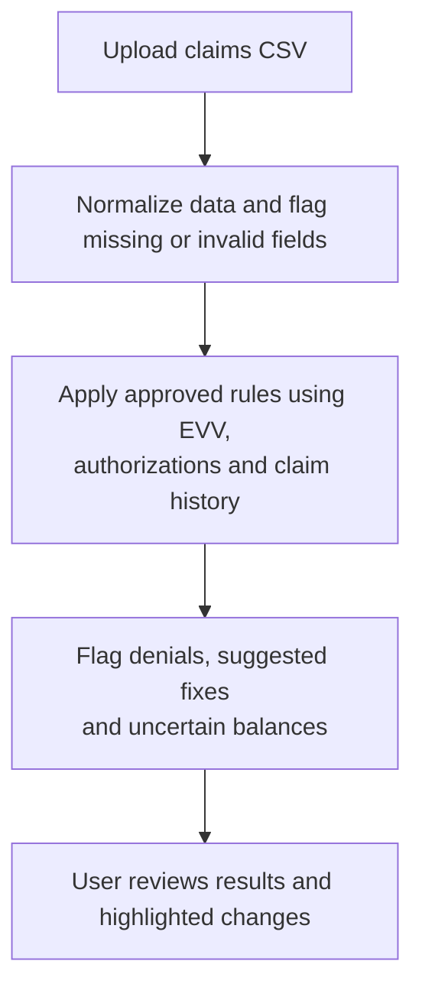

# Claim pre-check: design

This document defines the architecture and testing schedule. The app implements
code-generating rule updates using a standard AI skill, runtime example checks,
and an isolated historical replay/demo. Rule code can express novel checks over
the available data; claim execution remains deterministic. See
[app/README.md](app/README.md) for commands and implementation limits. Live-AI
integration is an explicit on-demand check; automated tests use test transports.

## Results from evaluation

The original experiment evaluated **1,090 unique claims**. These results describe
that experiment, rather than validation of the code-generating updater.

| Measure | Original rules-only prediction | After previous-claim review step |
|---|---:|---:|
| Claims receiving a paid/denied decision | 1,090 (100%) | **1,076 (98.72%)** |
| Correct paid/denied decisions, among automatic decisions | 1,057 / 1,090 (96.97%) | **1,053 / 1,076 (97.86%)** |
| Correct status and matching code set, among automatic decisions | 1,051 / 1,090 (96.42%) | **1,047 / 1,076 (97.30%)** |
| Actual denial code detected by the rules | 348 / 387 (89.92%) | **348 / 387 (89.92%)** |
| Actual denials still marked payable | 33 | **23: 17 D99 + 6 D10** |
| Claims classified as `check_previous_claims` | 0 | **14: 10 actually denied + 4 actually paid** |
| Actually paid claims marked payable | 703 / 703 | **699 / 703**; four sent to review |
| False definite denials on recorded paid claims | 0 / 703 | **0 / 703** |

Review cases are excluded from automatic-decision accuracy; a denial-code match means the reported code appears in the predicted set.

After sending **14 claims to review**, **23 actually denied claims are still predicted payable**:

- **6 D10 cases:** Denied under a Summit contract requirement, apparently whole-hour billing, which was not included in the supplied rules.
- **17 D99 cases:** Fifteen have only vague contact/review remarks; two mention the same whole-hour requirement but were recorded as D99 rather than D10.

Separately, **6 claims are correctly flagged as denied but have the wrong denial code**: four actual D10 cases flagged as D09, and two actual D02 cases flagged as D03.

**Design conclusion:** Keep deterministic checks, review uncertain balances, and obtain the missing contracts/correspondence before adding rules for these exceptions; there is no demonstrated benefit yet from per-claim AI calls.

## Proposed architecture

### Starting state

Build a small web app around the supplied, fixed CSV data format. AI maintains
the rules; the checker runs approved rule code without an AI call for each claim.
Use a provided Claude API key for rule updates.

| Mode | Initial rules | Initial history |
|---|---|---|
| Full app | All supplied manuals and bulletins implemented, versioned by payer and effective service date | Full available claims history |
| Historical test/demo | Base manuals only; bulletin updates introduced during the walkthrough | History restricted to the selected starting point, approximately June 2026 |

Full history provides context for current checks. Historical replay uses the
restricted state described under Testing so future outcomes cannot affect earlier
predictions.

### Rules updater and standard AI skill

The updater is a single chat interface headed **Create or update rules**. Its
composer is visible from the start and accepts a typed prompt, pasted Markdown,
an attached Markdown document, or a prompt and attachment together. Attachments
are staged until the user clicks **Send**, and can be removed before sending.
The AI may generate rule code beyond the current fixed parameter vocabulary,
including new rules that fit the available input data.
Missing evidence or ambiguous payer requirements should prompt clarification,
rather than an invented rule.

Give the AI a standard skill containing:

- The product context, claim-checking workflow, and distinction between safe
  formatting, uniquely supported automatic fixes and corrections requiring review.
- The input data formats, relevant clean example rows, and available supporting
  data such as authorizations, EVV visits, and prior claims.
- Existing rule code, payer versions, effective dates, and source documents.
- A worked example linking a source rule to the code added to implement it,
  affected claim rows, and the exact response format expected from the AI.
- The required output contract: proposed rule code that processes an already
  format-checked claims CSV with its supporting context and returns all applicable
  denial codes and reasons; affected synthetic claim rows with any supporting
  context needed to reproduce the examples; and a concise explanation of the
  update and its source.

Payer and effective-date applicability belong inside the generated code, using
conditions on each claim's payer and date of service. The AI does not return
proposal-level `payer_id` or `effective_from` fields. One update may cover several
payers and dates; each example row supplies its own payer and dates. Accepted
updates are versioned as code changes and run after earlier accepted updates.
Existing saved payer/date versions remain valid as the baseline.

For each initial request or follow-up, make one AI call to return the proposed
code update and example rows together. Do not display internal thinking. A helper
script validates the examples and executes both the currently accepted code and
the candidate code on the same inputs. The before/after results displayed in chat
must come from those executions, not from results asserted by the AI.

Each assistant response shows the rule update followed by well-formatted examples
whose outcomes actually change. Emphasize the changed result, denial codes,
reasons, and the claim facts needed to understand it. Keep unchanged control cases
in background checks. Compare every revision with the currently accepted rules so
the examples illustrate the overall proposed update, rather than only the last
chat edit.

The user can click a rule or an example to attach it to a follow-up message, or
request an edit directly. Each follow-up produces revised code and fresh examples
through the same process. Continue until the user clicks **Accept new rule**.
Acceptance activates the reviewed version after the checks described below;
unaccepted proposals do not affect normal claim checking. Keep the source, payer,
effective service date, and confirmed examples with the accepted version.

### Claims checker

The user uploads a claims CSV. The system:

1. Normalizes safe formatting differences, retaining the original values.
2. Fills missing payers from unambiguous authorization coverage, applies uniquely
   supported authorization references and approved modifiers, and records the
   evidence for each change. Explicit edits take precedence. Ambiguous matches,
   uncertain balances and other unresolved input problems remain for review.
3. Applies the approved rules with the relevant authorization, EVV, and historical
   state, returning every detected denial code with reasons and suggested actions.
4. Highlights automatic formatting and supported fixes, and separately identifies rows needing
   correction or review, including uncertain authorization balances.
5. Allows the user to correct fields or classifications and re-check the results.

Clicking a claim shows its matching EVV visits, durations and verification state,
plus referenced and related authorizations, coverage dates and remaining units
at the point the claim was checked. Flag mismatched or missing references clearly.

Business corrections require user review. A correction to one claim does not
silently change the payer rules; that requires a separate rule update.

**Rules setup and updates**

**Claims checking**

AI helps maintain the rules; claim-by-claim checks execute deterministically,
with unresolved evidence, ambiguous corrections and changes to care/amounts/dates
left for user review. The demo scores original submissions before automatic fixes;
corrected rows remain visible separately.

## Testing

There are two main validation tracks: **historical tests with known rules and
recorded outcomes**, and **runtime checks of newly generated rule code**. Developer
tests support both tracks. The schedule below distinguishes automatic runtime
checks from tests and demonstrations run on demand.

### When each check runs

| Check | Trigger / timing | Purpose |
|---|---|---|
| Historical replay | On demand through the replay script; also before a demo or after a material checker/updater change | Exercise the dated bulletin updates and claim batches against known expectations |
| Guided demo | On demand; the presenter advances the same replay script one stage at a time | Demonstrate the checker, chat-based rule updates, changing history, and measured results |
| Candidate execution validation | Automatically after each AI response, including every follow-up revision, and again before acceptance | Check code and example formats, bounded execution and output structure; errors block semantic approval |
| Semantic review | After successful execution checks for each proposal/revision | Request group approval of changed synthetic examples and separate approval of all changed historical predictions; disclose saved regressions and require a reason/source for regressions or historical changes |
| Candidate regression checks | Automatically after each candidate revision | Run saved, user-confirmed examples and unchanged control cases against the candidate |
| Acceptance checks | Automatically when the user clicks **Accept new rule**, before activation | Re-check the exact candidate being accepted and resolve conflicting confirmed expectations |
| Active-rule regression checks | Every claims batch check/recheck, including uploads, edits and rule activation | Run non-superseded saved cases against active rules; report failures on the dashboard independently of batch predictions |
| Claims input validation | Automatically on each claims/reference-data upload and after a user edits a claim | Check the actual inputs before deterministic processing; this does not run the development test suite |
| Unit and pipeline/API tests | On demand during development; after relevant code changes and before a release or demo | Verify normalization, rule boundaries, state handling, and integrated workflows |
| Browser tests | After UI/workflow changes and before a demo or release; also on demand | Verify the upload, rule review, follow-up chat, acceptance, results, corrections, and export flows |
| Historical accuracy report | At each replay stage; also on demand for a selected dataset and rule version | Report agreement with recorded outcomes, review workload, false alarms, and mismatched rows |

### Historical replay and demo

The replay script advances a simulated system date and controls which rules,
history, and unlabelled claim batches are available at each stage. Start from an
isolated fresh state with base manuals only and history up to approximately June
2026. Keep demo/test state separate from the full app's saved rules and history.

The sequence is:

1. Check the initial claim batch up to the first update and display its results.
2. Advance to the first bulletin stage, making only the history available by that
   point visible. Submit Northwind's July bulletin through the rules updater,
   review its examples, and accept the update.
3. Check the next period's claims, including both sides of Northwind's
   **1 August 2026** service-date boundary. The filing limit changes from 30 to
   **45 calendar days**. A claim submitted 40 days after a 31 July service fails
   the filing check; one submitted 40 days after a 1 August service passes it.
4. Advance the available history to the second bulletin stage. Submit Harbor's
   August notice, review it, and accept the update.
5. Check the following period, including both sides of **1 September 2026**.
   Weekend T1019 requires U3 from that date; weekday T1019 retains U2.

Advancing the simulated date changes data availability; it must not rewrite
service dates or activate a rule merely because its publication date has arrived.
Select versions by payer and date of service. Do not expose a batch's recorded
outcomes to the predictor or AI before that batch is evaluated. Reveal outcomes
for reporting afterward and make them available as history only at the appropriate
later stage. Retain the checker's handling of earlier unresolved submissions.

At each stage, check the entire pipeline and compare affected outcomes, earlier
service dates, unrelated payers, authorization usage, daily totals, duplicates,
and pending-claim review with the expected behaviour. A scripted test can use a
repeatable AI fixture; a live demo can use Claude. Assess generated code by its
behaviour and output contract, rather than requiring identical code or prose.

Some recorded outcomes depend on missing contract terms or unexplained denials.
Maintain an explicit, reviewed list of these known exceptions with reasons. The
historical test passes when every other row matches its expected outcome and
there are no unexpected regressions. Do not silently expand the exception list
to make a run pass. The demo and report must still show overall accuracy across
all rows and list every mismatch, including known exceptions.

### Runtime checks for new rules

Novel rules generally have no independently labelled dataset. Runtime checks can
establish that a candidate executes correctly and produces reviewable results;
they cannot establish its accuracy simply because its own examples pass.

After **each AI response**, the helper script:

1. Validates the proposed code's input/output contract and the example rows'
   formatting, required fields, and supporting context. Reports execution errors
   and malformed results before presenting the proposal as ready for acceptance.
2. Executes the accepted and candidate code on identical example inputs and
   records the actual statuses, complete code sets, and reasons. Only examples
   with changed outcomes appear in the chat.
3. Runs saved confirmed examples and relevant control cases, including earlier
   effective dates and unrelated payers. Shows any conflicting expectations.

Keep these checks general enough to permit novel rule implementations. A
candidate need not fit a predefined list of rule parameters. Missing labels are
not a reason to prevent the user from reviewing a new rule, and AI-generated
expectations are suggestions rather than independent evidence.

### Unit tests

Expected results come from source rules or a reviewed specification, rather than
copying the implementation's output. Controlled fixtures assert the complete
expected code set, including the absence of unintended failures.

| Area | Examples and expected behaviour |
|---|---|
| Normalization | Payer aliases, whitespace, lowercase modifiers and US dates become canonical; cleaning twice makes no further changes; unknown values are flagged |
| EVV | Only verified visits count; aggregate visits before rounding; overnight visits belong to the clock-in date; test Northwind's 7/8-minute boundary and other payers' complete units |
| Authorizations | Missing reference → D07; wrong payer/patient/service/date → D08; exact remaining balance passes, one unit over → D02 |
| Filing and modifiers | Exact deadline passes, next day fails; test both sides of effective dates, plus Harbor weekdays and weekends |
| Historical state | Paid claims consume units; denied claims do not; both establish duplicate history; corrected claims are exempt; Harbor totals span services |
| Uncertainty and output | Pending claims trigger review only when they could change the balance decision; exclude later claims; retain definite denials; output every detected code and keep proposed edits separate |
| Generated rule code | Validate the input/output contract, execution limits, malformed examples, failure handling, persistence, and novel rules outside the legacy parameter vocabulary |

The existing app and experiment tests provide a starting point. Browser coverage
must exercise the user-facing workflow; passing CSV or API tests alone does not
establish that the interface works. Keep ordinary automated tests repeatable
without a live API key; run live-AI integration checks explicitly on demand.

### End-to-end tests

These run during development after relevant changes, before a release/demo, and
on demand, as specified in the testing schedule.

- **Upload to results:** Process a small fixture containing payable, denied,
  multiple-failure, malformed and review cases through the full pipeline; verify
  displayed changes, explanations and downloaded CSV, preserving source data.
- **Sequential batch:** Include prior paid/denied claims, authorization exhaustion,
  daily limits, duplicates and pending submissions; check results against an
  independently worked-through ledger.
- **Rule update:** Run the same dated fixtures before and after activating an
  update; affected outcomes must change as specified, while earlier service
  dates and unrelated payers retain their expected results.
- **Browser workflow:** Exercise upload, chat revisions, example comments, rule
  acceptance, claim review/corrections, and export. Also verify dated demo controls
  and restoration of full-app state.

### Using examples to review a rule update

Automated testing and user acceptance are **two different purposes that can
share the same examples**: tests verify agreed behaviour, while user review
establishes the expected behaviour where a new rule is unclear.

1. Show the source passage and affected examples with relevant history and actual
   before/after results. Include passing, failing and boundary cases where they
   change; run unaffected cases in the background.
2. For established rules, compare expected and actual results. Each displayed
   example has only a **Raise issue** button, which attaches its context to chat.
   Users can request a correction or payer clarification without approving
   examples individually.
3. Show which outcomes differ under the overall proposed update and why. Let the
   user comment on a rule/example or request another edit; record a reason/source
   for deliberate changes to earlier confirmed expectations.
4. After group approval of synthetic changes and separate approval of historical
   changes, a single acceptance action saves the update without per-example clicks.
   Save changed outputs as versioned regression baselines
   with payer, effective dates and source. Distinguish these from independently
   confirmed expectations; retain earlier-version cases and rerun runtime
   validation and regressions before activation.

Cases awaiting clarification remain explicitly unresolved and are not saved as
confirmed tests. Unchanged control cases do not require a user decision.

When the user clicks **Accept new rule**, rerun validation and regressions against
the exact candidate and current state. Block activation for execution/format
errors or unresolved conflicts with confirmed expectations. A deliberate change
to an earlier confirmed expectation requires a recorded reason/source and user
confirmation. Historical prediction changes also require explicit group approval
and a reason/source, with all affected rows available in the chat. Show payer and
service dates to check effective-date conditions; retroactive changes may be
legitimate. Bind approval to the evaluated candidate and comparison results; reject
stale approval after revisions or state changes. Do not run the full historical
demo or invoke the entire developer test suite on every chat message or ordinary
claims upload.

AI may propose examples, but AI-generated expectations alone are not independent
validation. A one-off user correction to a claim should not silently change a
payer rule; broader changes need explicit confirmation and supporting evidence.

## Evaluation limitations

For recorded denials, the historical metric counts a code match when the recorded
code appears in the predicted set; it does not prove equality of the complete code
set. Controlled tests should use full expected sets.

The more flexible updater allows new rules when supporting payer evidence is
supplied. Historical replay on already inspected data is a diagnostic/demo, not a
fresh accuracy estimate; use a new holdout for future claims about generalization.
Report review workload and false alarms alongside accuracy. See
[experiment_results.md](experiment_results.md) for the full evaluation.
