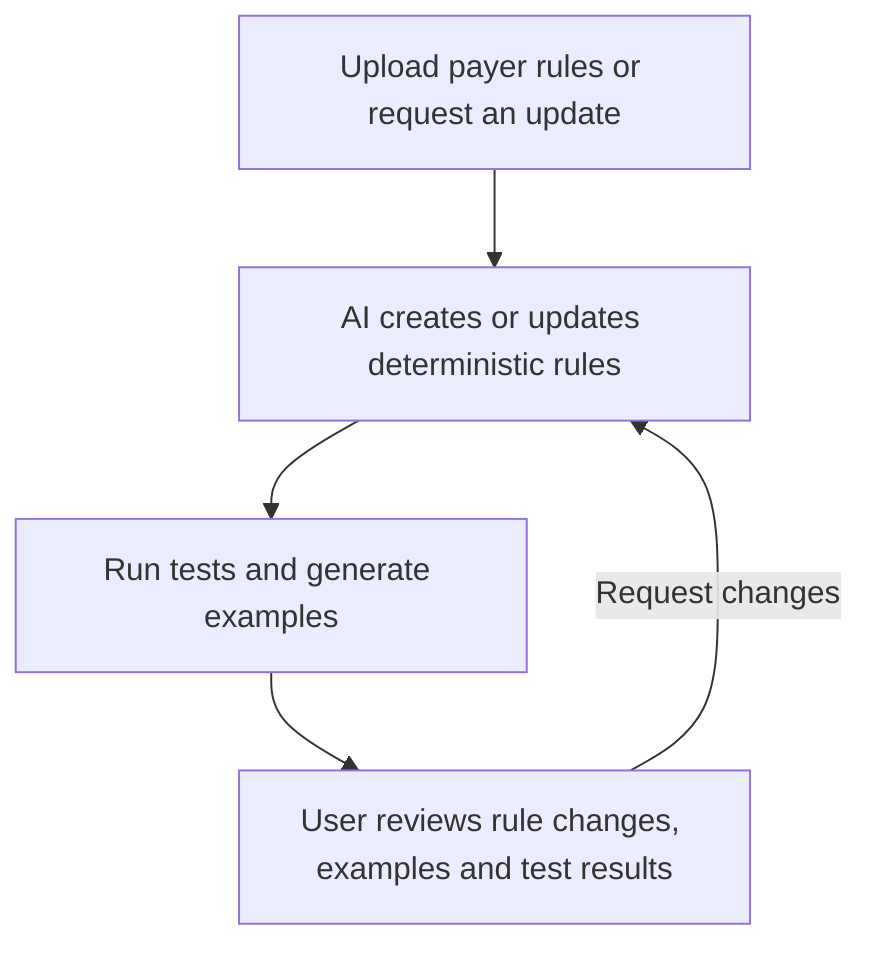
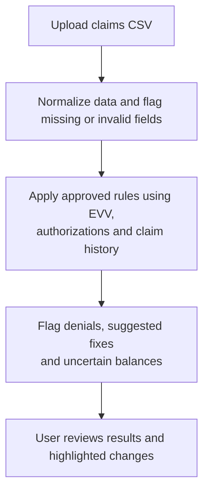

This is the final design. 

## Results from evaluation

Evaluated on **1,090 unique claims**.

| Measure | Original rules-only prediction | After previous-claim review step |
|---|---:|---:|
| Claims receiving a paid/denied decision | 1,090 (100%) | **1,076 (98.72%)** |
| Correct paid/denied decisions, among automatic decisions | 1,057 / 1,090 (96.97%) | **1,053 / 1,076 (97.86%)** |
| Correct status and matching code set, among automatic decisions | 1,051 / 1,090 (96.42%) | **1,047 / 1,076 (97.30%)** |
| Actual denial code detected by the rules | 348 / 387 (89.92%) | **348 / 387 (89.92%)** |
| Actual denials still marked payable | 33 | **23: 17 D99 + 6 D10** |
| Claims classified as `check_previous_claims` | 0 | **14: 10 actually denied + 4 actually paid** |
| Actually paid claims marked payable | 703 / 703 | **699 / 703**; four sent to review |
| False definite denials on recorded paid claims | 0 / 703 | **0 / 703** |

Review cases are excluded from automatic-decision accuracy; a denial-code match means the reported code appears in the predicted set.

After sending **14 claims to review**, **23 actually denied claims are still predicted payable**:

- **6 D10 cases:** Denied under a Summit contract requirement, apparently whole-hour billing, which was not included in the supplied rules.
- **17 D99 cases:** Fifteen have only vague contact/review remarks; two mention the same whole-hour requirement but were recorded as D99 rather than D10.

Separately, **6 claims are correctly flagged as denied but have the wrong denial code**: four actual D10 cases flagged as D09, and two actual D02 cases flagged as D03.

**Design conclusion:** Keep deterministic checks, review uncertain balances, and obtain the missing contracts/correspondence before adding rules for these exceptions; there is no demonstrated benefit yet from per-claim AI calls.

## Proposed architecture:
We can prototype this as a simple web app. There should be an option to add in rules files. We assume that this example data format is fixed. 

Initially:
Users input what rules they have been given. AI parses this into a claim sorter. We will feed the AI clean example data and other context also. 

When a rule is updated:
Users request an update to the rules. AI implements the edits in a chatbot interface, generating and showing the user example data. 

AI calls should use a provided claude API key. 

The users input a .csv of claims (any number of claims). 

The system will:
- Apply sensible normalisation. 
- Flag obvious issues such as missing fields. 
- Apply the rule set, applying predicted denial codes and suggested next actions. 
- Flag all issues found to the user (both rows which had simple fixes applied - show with highlighting - and separately, all rows which must be corrected).
- Allow the user to correct any of its classifications.

**Rules setup and updates**

**Claims checking**

AI helps maintain the rules; claim-by-claim checks execute deterministically,
with unresolved evidence and proposed business corrections left for user review.

## Testing

Use small, explicit examples to verify each rule, then complete claim batches to
verify that cleaning, historical state and results work together; the existing
22 prototype tests provide a starting point for the proposed app.

### Unit tests

| Area | Examples and expected behaviour |
|---|---|
| Normalization | Payer aliases, whitespace, lowercase modifiers and US dates become canonical; cleaning twice makes no further changes; unknown values are flagged |
| EVV | Only verified visits count; aggregate visits before rounding; overnight visits belong to the clock-in date; test Northwind's 7/8-minute boundary and other payers' complete units |
| Authorizations | Missing reference → D07; wrong payer/patient/service/date → D08; exact remaining balance passes, one unit over → D02 |
| Filing and modifiers | Exact deadline passes, next day fails; test both sides of effective dates, plus Harbor weekdays and weekends |
| Historical state | Paid claims consume units; denied claims do not; both establish duplicate history; corrected claims are exempt; Harbor totals span services |
| Uncertainty and output | Pending claims trigger review only when they could change the balance decision; exclude later claims; retain definite denials; output every detected code and keep proposed edits separate |

Expected results should come from the source rule or a reviewed specification,
not simply copy the implementation's output. Controlled examples should assert
the **complete expected code set**, including absence of unintended failures.

### End-to-end tests

- **Upload to results:** Process a small fixture containing payable, denied,
  multiple-failure, malformed and review cases through the full pipeline; verify
  displayed changes, explanations and downloaded CSV, preserving source data.
- **Sequential batch:** Include prior paid/denied claims, authorization exhaustion,
  daily limits, duplicates and pending submissions; check results against an
  independently worked-through ledger.
- **Rule update:** Run the same dated fixtures before and after activating an
  update; affected outcomes must change as specified, while earlier service
  dates and unrelated payers retain their expected results.

For example, Northwind's July bulletin changes the filing limit for service
on **1 August**, not 1 July: a claim submitted 40 days after a 31 July service
fails, while one submitted 40 days after a 1 August service passes the filing
check. Test Harbor's modifier change separately around **1 September**.

Once the web app exists, add a browser test of upload, rule approval and result
review; the current CSV pipeline tests do not establish that the UI works.
Historical evaluation remains separate: compare reported codes by set membership
and report review workload and false alarms, using a fresh holdout for new work.

### Using examples to review a rule update

Automated testing and user acceptance are **two different purposes that can
share the same examples**: tests verify agreed behaviour, while user review
establishes the expected behaviour where a new rule is unclear.

1. Show the source passage and a small set of examples: one passing, one failing,
   boundary dates/values and an unaffected case, with relevant history visible.
2. For established rules, show expected versus actual results; for unresolved
   cases, ask the user to choose the correct status, code set or review outcome,
   with an option to say that payer clarification is needed.
3. Show which outcomes differ under the proposed update and why; request a
   reason/source for changes to previously approved expectations.
4. Save confirmed examples with their expected outputs, payer, effective dates
   and supporting source as versioned acceptance tests; retain earlier-version
   cases and rerun unit, batch and regression tests before activation.

AI may propose examples, but AI-generated expectations alone are not independent
validation. A one-off user correction to a claim should not silently change a
payer rule; broader changes need explicit confirmation and supporting evidence.
