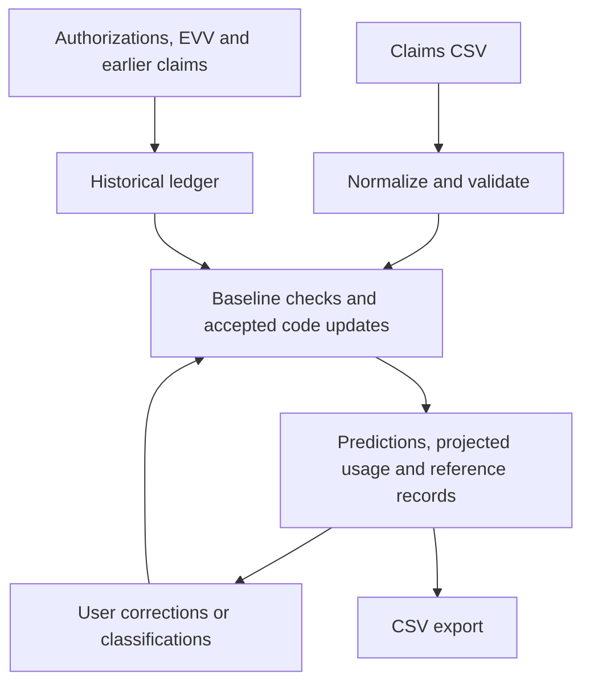
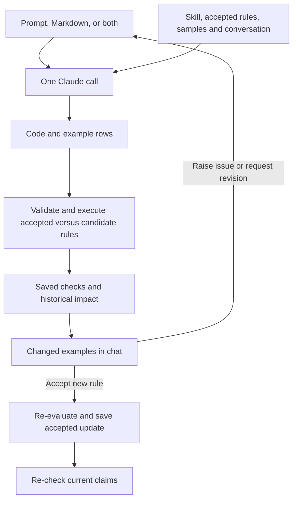

# Technical documentation

This document describes the implemented app in `app/`, including its historical
web demo and command-line tools. [README.md](README.md) is the short user guide;
[the test sources](app/tests/) cover the executable checks; the [design](plans/design.md#testing) documents their timing. The
exploratory code in `experiment/` has its own [README](experiment/README.md) and
[results](plans/experiment_results.md); its metrics are not interchangeable with the app's.

## Contents

- [Architecture](#architecture)
- [Configuration and startup](#configuration-and-startup)
- [Input data](#input-data)
- [Claim processing](#claim-processing)
- [Denial codes](#denial-codes)
- [Results and exports](#results-and-exports)
- [Rules assistant](#rules-assistant)
- [Generated rule contract](#generated-rule-contract)
- [Rule execution worker](#rule-execution-worker)
- [State and persistence](#state-and-persistence)
- [Historical demo and evaluation](#historical-demo-and-evaluation)
- [HTTP API](#http-api)
- [Command-line tools](#command-line-tools)
- [Limitations and troubleshooting](#limitations-and-troubleshooting)

## Architecture

The server is Python's `ThreadingHTTPServer`, bound to `127.0.0.1`. It serves a
plain HTML/CSS/JavaScript frontend and a JSON API. One shared `Session` holds the
current data, rules, claims and drafts. Mutating session operations use an `RLock`.
There is no database, framework, frontend build, login or per-user isolation.

Claims are checked deterministically. Claude is called only for rule maintenance;
ordinary CSV uploads and re-checks never require a model call.





### Source map

| File | Responsibility |
|---|---|
| `app/server.py` | Local HTTP/static server, endpoint routing, request limits and error responses. |
| `app/claimcheck/session.py` | Shared state, uploads, re-checks, edits, overrides, draft actions and demo switching. |
| `app/claimcheck/normalize.py` | CSV structure, canonical values, input issues, repeated/conflicting claim IDs. |
| `app/claimcheck/pipeline.py` | Reference datasets, ordered batch execution, reference-record attachment, summaries and export. |
| `app/claimcheck/engine.py` | Baseline payer checks, provisional ledger and invocation of accepted code. |
| `app/claimcheck/rules.py` | Baseline/manual/bulletin parameters, legacy dated versions, global code updates and JSON persistence. |
| `app/claimcheck/examples.py` | Scenario validation, synthetic reference worlds, execution and mechanical boundary cases. |
| `app/claimcheck/drafts.py` | AI context, proposal application, comparisons, saved-example regressions and acceptance. |
| `app/claimcheck/ai.py` | Claude request/response handling and structured proposal schema. |
| `app/skills/payer-rule-updater/SKILL.md` | Standard AI instructions, available inputs, output contract and worked update. |
| `app/claimcheck/code_rules.py` | Restricted Python validation and bounded subprocess execution. |
| `app/claimcheck/history.py` | Observed-outcome history replay, agreement metrics and candidate impact. |
| `app/claimcheck/replay_demo.py` | Dated demo references, monthly uploads, historical comparison and scripted replay. |
| `app/claimcheck/demo_fixtures.py` | Source-transcribed Northwind/Harbor proposals used by repeatable replay tests. |
| `app/web/index.html`, `app.js`, `style.css` | Claims dashboard, details, chat, attachments, acceptance and demo controls. |
| `app/check_claims.py`, `check_examples.py`, `replay_history.py` | On-demand command-line entry points. |
| `app/tests/` | Developer and browser checks; see [the test sources](app/tests/). |

## Configuration and startup

Commands below assume the repository root:

```bash
python3 app/server.py
python3 app/server.py --port 8001
python3 app/server.py --demo
python3 app/server.py --demo --as-of 2026-07-31
python3 app/server.py --state-dir /tmp/my-claimcheck-state
```

| Setting | Default | Behaviour |
|---|---|---|
| `--port` | `8000` | HTTP listener port; host remains `127.0.0.1`. |
| `--demo` | Off | Starts an isolated historical session instead of showing full-app data. |
| `--as-of` | `2026-04-30` | Initial simulated date when `--demo` is used. |
| `--state-dir` | `app/state/`, relative to the source file | Directory containing the full-app `rules.json`. Explicit relative paths use the process working directory. |
| `ANTHROPIC_API_KEY` | Unset | Enables live rule-assistant requests. Not needed by the deterministic checker. |
| `ANTHROPIC_MODEL` | `claude-sonnet-5-5` | Overrides the configured model name; actual provider availability is not established by the app. |

Python 3.10+ is required. Generated-code execution uses Unix `resource` limits and
`/tmp`; Linux is the development/test environment. Core functionality has no pip
requirements. Browser checks additionally require Firefox and geckodriver.

At startup, sample references load from `app/sample_data/`. Missing saved rules,
or a snapshot exactly matching the untouched base manuals, are initialized/upgraded
to `full_store()`: manuals plus both supplied bulletins. Custom saved snapshots
are preserved. Starting in demo mode also initializes the full session before
switching to temporary demo rules.

The skill and AI system instructions load when the Python module is imported.
Restart the server after changing backend code, model environment settings or
the skill. The app does not implement hot reload or automatic `.env` loading.

## Input data

All CSVs use a header row and UTF-8 text; a leading BOM is tolerated. Extra/missing
CSV cells cause a structural error. Claims must contain every standard column,
including columns whose values may be blank. Extra uploaded columns are preserved
in raw rows/export but are not passed to rule code.

### Claims CSV

The exact header is:

```csv
claim_id,agency_id,payer,patient_id,service_code,date_of_service,submitted_date,units,auth_id,modifier,frequency_code,original_claim_id,billed_amount
```

| Field | Accepted meaning/format |
|---|---|
| `claim_id` | `C` plus six digits; normalized to uppercase. |
| `agency_id` | `AG` plus three digits. |
| `payer` | Known payer ID or supported alias, normalized to `PY01`, `PY02` or `PY03`. |
| `patient_id` | `PT` plus four digits. |
| `service_code` | `T1019`, `T1005` or `S5125`; normalized to uppercase. |
| `date_of_service` | ISO `YYYY-MM-DD` or US `MM/DD/YYYY`; normalized to ISO. |
| `submitted_date` | Same date formats; cannot precede service date. |
| `units` | Positive integer; one unit represents 15 minutes. Leading zeros are removed. |
| `auth_id` | Blank or `AUTH` plus five digits. Blank is a business-rule issue, normally D07, rather than a malformed row. |
| `modifier` | Blank, `U1`, `U2` or `U3`; uppercase after normalization. |
| `frequency_code` | `1` for original or `7` for corrected. |
| `original_claim_id` | Blank or `C` plus six digits; required for frequency `7`. |
| `billed_amount` | Nonnegative decimal amount with at most two decimal places. |

Known payer aliases include Northwind/Northwind HP/Northwind Health Plan;
Harbor/Harbor Medicaid/Harbor Medicaid Plan; and Summit/Summit Care/Summit Care
Partners. Aliases ignore case and repeated whitespace. Unknown payers/services
are flagged instead of guessed. The normalizer trims whitespace, standardizes
supported dates and casing, and records before/after changes without changing
uploaded source values.

### Reference CSVs

| Dataset | Required columns |
|---|---|
| Authorizations | `auth_id,patient_id,payer_id,service_code,start_date,end_date,units_authorized` |
| EVV visits | `visit_id,caregiver_id,patient_id,service_code,clock_in,clock_out,verification_status` |
| Recorded claim history | All claim columns plus `status,paid_amount,denial_code,remark` |

EVV visit IDs are `V` plus six digits; caregiver IDs are `CG` plus four digits.
Visit timestamps use `YYYY-MM-DD HH:MM`. Verification states are `verified`,
`rejected` and `manual_edit_pending`. Only `verified` time supports billing.
Authorization units are positive integers. Recorded history statuses are `paid`
or `denied` for settled outcomes. `pending` denotes an unknown outcome; blank,
`unknown`, `unresolved` and `submitted` normalize to `pending`. Pending historical
claims are forecast chronologically without changing their recorded status.

Reference loading canonicalizes supported fields, deduplicates identical cleaned
records and sorts history by submission date. Problems are reported in Reference
data. Reference ingestion is not a complete integrity gate: reported field errors
do not necessarily prevent replacement, and malformed references can still stop
later processing. Correct the source instead of assuming every reported problem
was automatically repaired.

Full-app reference replacements are in-memory and trigger re-checks. In demo mode,
manual reference replacement/reload is blocked; advance the simulated date instead.

## Claim processing

1. Parse/normalize the upload and retain raw values and audit changes.
2. Mark identical normalized rows with the same claim ID as repeated exports.
   A reused ID with different normalized values flags the conflicting rows for
   correction. Repeated exports are not billed/checked twice.
3. Build an initial ledger from available recorded history. Paid claims consume
   authorization and daily units; paid and denied submissions establish duplicate
   history. Retain the earlier claim records for correction references.
4. Process valid unique batch rows by submission date, breaking ties by uploaded
   line number. Return results in uploaded order.
5. Select the legacy baseline parameters by payer and service date, then perform
   the checks below. Apply any legacy version-specific code, followed by global
   accepted code updates in acceptance order.
6. Predict historical claims whose outcomes are pending using the same checker.
   Confirmed paid history consumes recorded units; predicted paid history and
   earlier payable batch rows reserve provisional units. Denied predictions
   consume no units, while prior submissions still establish duplicate history.
7. Update the ledger for subsequent rows and record which usage is provisional.
   User paid/denied classifications affect projected usage without becoming
   confirmed payer outcomes. Invalid inputs and unavailable rules produce an
   explicit inability to check rather than an invented payment prediction.
8. Attach relevant reference records, preserve the prediction separately from any
   classification override, and build the dashboard/export.

### Removing a batch row

The claim detail provides **Delete row**, backed by
`DELETE /api/claims/line/{line}`. The session removes exactly that row from its
in-memory upload, remaps later line-based edits, removes unused claim overrides,
and rechecks the remaining batch. An override shared by another row with the
same claim ID is retained. Authorization balances, duplicate references, runtime
regressions and the demo report are recalculated. Deleted rows are excluded from
the export, while source files and historical reference data remain unchanged.
Line numbers refer to the current batch and shift after removal. Deleting the
last row produces an empty batch. Unknown lines return 404. The UI disables the
delete button during the request to prevent repeated clicks deleting another row.

### Duplicate submission details

D05 results include `duplicate_submissions` in processing order, identifying each
prior submission as `batch` (with its exact uploaded line) or `history` (with its
recorded outcome), plus the complete claim fields. This metadata is captured
before the current claim enters the ledger. Historical and batch occurrences
remain distinct even if they share an ID.

In a duplicate warning, a batch claim ID is a link that selects its row, clears
filters and opens its details. Repeated export rows also link to their original
row. A historical duplicate shows service/submission dates, payer, patient,
service and units, with expandable complete details. Paid history is described
as submitted and accepted; denied history is explicitly described as previously
denied. Both still establish a prior submission under the existing duplicate rule.

### Automatic corrections

`run_batch()` defaults to automatic fixing. It works on copies, retaining raw
uploaded fields and normalisation changes. First it fills blank payers from valid
coverage records matching patient, service and inclusive service dates. A supplied
authorization ID must match; otherwise all matching coverage must identify one
payer. Unknown nonblank payer names are not inferred. Identical references are
collapsed; conflicting authorization IDs and invalid reference records cannot
justify an automatic correction. Duplicate detection and input validation rerun
after payer inference.

The checker then processes claims by submission date/line number, applying accepted
rule-defined modifiers and unique authorization suggestions before recording each
decision. Invalid authorization/modifier values may be repaired when their
replacement is uniquely supported; other input errors still block checking.
Authorization autofill requires sufficient predicted balance, using the projected ledger. A user-edited field is never
automatically overwritten. Remaining suggested fixes can still be accepted manually.
No units, amounts, patient identities, service dates or submission dates are invented.

The result includes `automatic_fixes` (field, before/after, explanation, reference
IDs and applicable rule version) and the corrected `clean` claim. The **Auto-fixed**
tile filters rows with these corrections. The row detail shows the audit separately
from formatting and user edits. Every recheck recalculates autofill from the upload,
current references and explicit edits; undoing user edits restores that behaviour.
CSV source columns remain unchanged, with JSON `automatic_fixes` and `checked_claim`
columns providing the audit and corrected values. Classification overrides remain
separate from the checker prediction.

`autofix=False` is available for diagnostics of original submissions. The web demo
runs this second pass on the same label-free batch/context and attaches
`original_prediction` to each corrected row. Its accuracy report and historical CLI
replay compare original submission predictions with recorded outcomes; the dashboard
continues to display corrected claims. The report labels this basis explicitly.
Rule-update synthetic regression scenarios and historical impact likewise continue
to test original inputs against the rules, without implicitly correcting them.

### Baseline payer rules

| Rule | Northwind (`PY01`) | Harbor (`PY02`) | Summit (`PY03`) |
|---|---|---|---|
| EVV | Required; aggregate verified minutes, then use the 8-minute rounding rule. | Required; complete 15-minute units only. | Required; complete 15-minute units only. |
| Authorization | Required; matching payer/member/service, inclusive coverage dates and sufficient remaining units. | Same. | Same. |
| Filing | 30 calendar days; supplied July bulletin extends to 45 for service on/after 1 August 2026. | No stated limit in supplied manual. | 60 calendar days. |
| T1019 modifier | No baseline requirement. | U2; supplied August notice requires U3 on weekends for service on/after 1 September 2026. Weekdays retain U2. | No baseline requirement. |
| Daily maximum | None stated. | 32 paid units per member/day across services. | None stated. |
| Duplicates | Checked; original submissions with matching payer/member/service/date can fail. | Same. | Same. |

For Northwind, 22 verified minutes support one unit and 23 support two. Verified
visits are aggregated before rounding, and overnight visits belong to the
clock-in date. Missing verified visits produce D01; verified time insufficient
for billed units produces D09. Exact filing limits and exact balances pass;
one day or one unit over fails.

A corrected claim is exempt from the ordinary duplicate rule. If its original
reference is missing from the ledger or identifies another claim, it cannot be
checked until the reference is corrected, unless another failure already makes it denied.

### Reference records in the row detail

The current UI can edit payer, patient, service, dates, units, authorization,
modifier, frequency and original-claim reference. Authorization references and
modifiers are applied automatically when uniquely
supported and not explicitly user-edited; ambiguous cases remain suggestions. A
blank payer can also be inferred from authorization coverage. Other corrections
are entered manually. The edit API accepts standard claim fields, while export retains the
original uploaded values.

EVV records match patient, service and clock-in date, including unverified visits
so the user can see why some time was excluded. Details include visit/caregiver
IDs, times, durations and verification states.

Authorizations include the referenced record even when it belongs to the wrong
payer/patient/service, plus related records for the claim's payer/patient/service.
Coverage mismatches are identified. The referenced valid authorization's displayed
remaining units come from the ledger when that row was checked, not the batch's
final balance. The panel separately identifies predicted usage included in that
projected balance. Confirmed outcomes and provisional forecasts remain distinct.

## Denial codes

| Code | Meaning |
|---|---|
| D01 | No verified EVV visit for the service date. |
| D02 | Units exceed remaining authorization units. |
| D03 | Claim received after the payer's filing limit. |
| D04 | Missing or invalid modifier. |
| D05 | Duplicate claim. |
| D06 | Daily unit maximum exceeded. |
| D07 | Prior authorization number missing. |
| D08 | Authorization invalid for payer, patient, service or service date. |
| D09 | Billed units exceed EVV-supported time. |
| D10 | Payer contract-specific denial. |
| D99 | Other payer denial. |

The baseline cannot determine unavailable contract terms or unexplained D99
conditions. Summit whole-hour billing is suggested by historical remarks but the
contract and exact effective scope are not supplied. It is not silently added to
the full-app baseline. Tests containing a whole-hour rule use an explicitly
synthetic test contract. A future accepted update may implement such a rule when
the user supplies evidence.

Returning D99 as a rule failure produces a denied result like other failure codes.

Rule-code output can use a `D` followed by two digits with its own meaning/reason;
the supplied CSV input/reference vocabulary remains fixed. All returned failures
are reported, sorted by code, rather than selecting one primary denial.

## Results and exports

### Status versus dashboard category

| Result status | Dashboard category | Interpretation |
|---|---|---|
| `paid` | `payable` | No implemented violation detected: “Likely paid.” |
| `denied` | `denied` | One or more rule failures: “Likely denied.” |
| `unable_to_check` | `unable_to_check` | Missing rules, invalid correction reference or execution failure; correct the cause before checking. |
| `unable_to_check` with input errors | `must_correct` | Fix the input before checking. |
| `duplicate_row` | `duplicate_row` | Repeated exported row; not processed twice. |

The All claims count includes returned repeated rows. Auto-formatted counts rows
with normalization changes and overlaps outcome categories. The browser displays
at most 1,500 filtered rows at once; export is not restricted to those visible rows.

A user override changes the row's effective status/codes and later ledger use;
`predicted_status` and `predicted_codes` retain the checker's result. Category
filters/tiles use the category computed before the override, while code totals
use the final codes. They should not be read as a recalculated category summary
of user classifications.

### JSON result structure

`Session.results()` returns `summary`, `rows` and `demo_report` (null outside the
demo or when a comparison is unavailable). Important row fields are:

| Group | Fields |
|---|---|
| Identity/input | `line` (first data row is line 2), `claim_id`, `raw`, `clean`, `edits`, `duplicate_of`. |
| Input audit | `changes` (`field,before,after`), `issues` (`field,severity,message`). |
| Decision | `status`, `category`, `denial_codes`, `summary`, `predicted_status`, `predicted_codes`, `override`. |
| Explanations | `failures` (`code,meaning,reason,suggestion,rule`), `warnings`, `proposed_changes`, `rule_version`. |
| Evidence | Verified minutes/visit IDs, baseline supported units and filing limit, filing days, remaining authorization, paid daily units, earlier submissions. |
| Supporting records | `reference_data.evv_visits`, including duration; `reference_data.authorizations`, including referenced flag and mismatch issues. |
| Projected usage | Evidence includes `authorization_predicted_usage` and `authorization_provisional_claim_ids`; these identify forecasts included in the remaining units. |

Evidence includes baseline computations; generated transforms can alter failure
conditions without changing those baseline evidence fields. Read the final
failure reasons and accepted code/source when an extension changes a threshold.

### CSV output

Original uploaded columns/values are retained. Unless a name already exists in
the upload, these result columns are appended:

| Column | Contents |
|---|---|
| `predicted_status` | Checker's status before classification override. |
| `predicted_denial_codes` | Complete predicted code set joined with semicolons. |
| `reasons` | Failure reasons separated by vertical bars, or the summary when no failure list exists. |
| `suggested_actions` | Failure actions plus any earlier-claims reconciliation action. |
| `proposed_changes` | JSON object of suggested field values; empty when none. |
| `normalisation_changes` | Automatically applied field before/after audit. |
| `user_edits` | Explicit saved field edits. |
| `input_issues` | Unresolved validation messages. |
| `warnings` | Checker warnings. |
| `user_status` | Classification override, if supplied. |
| `user_denial_codes` | Override codes joined with semicolons. |
| `user_note` | User's override reason/source. |

The export is a results/audit file, not a rewritten clean submission file: accepted
field edits are recorded separately and do not overwrite original source columns.
Reusing result-column names in an upload should be avoided because generated
result values take precedence for those names.

## Rules assistant

The persistent composer accepts a prompt, pasted Markdown, a `.md`/`.markdown`
attachment, or a prompt plus attachment. Selecting a file does not submit it.
The user can remove it before Send; empty documents are rejected without losing
the prompt. The visible chat separates prompt text, attachment name/document
preview and selected-example context. Attachments also work on follow-ups.

Each send makes one model request, without an autonomous tool loop or retry.
An active draft receives a follow-up; after acceptance, a new send starts another
draft. One response provides a proposed code update and examples, or asks a
clarifying question. Merely proposing or discussing a rule changes no active rules.

### AI context and response

The system prompt contains the [standard skill](app/skills/payer-rule-updater/SKILL.md)
and denial-code meanings. The request context includes accepted legacy rules and
global updates, baseline `check_claim` source, up to two clean historical claim
samples with outcome fields removed, up to two authorizations and two EVV visits,
base payer manuals, and the current unaccepted code/summary/errors. The conversation
includes submitted prompts, attachment text and any selected rule/example context.
This content is sent to the configured Claude service; the deterministic checker
itself does not send claims for individual AI classification.

The `propose_rule_update` tool schema defines `assistant_message`, optional
`clarifying_question`, `code`, `summary`, `source_quote` and `examples`. Only
`assistant_message` is schema-required at the proposal level so a clarifying
reply is possible. Each tool example requires title, claim and expected-code
fields; the claim must carry payer, service, dates and units. Backend scenario
logic also supports null/absent proposed expectations for manually supplied cases.

There are no proposal-level `payer_id`, `payer_name`, `effective_from` or `params`
fields in the AI contract. Applicability belongs inside code. The client uses
`tool_choice: auto` and instructs the model to call the tool; it also handles a
plain-text reply as an assistant message without a code proposal. The request
allows up to 12,000 output tokens and uses a 90-second HTTP timeout.

### Validation and acceptance

`drafts.evaluate()` is called when a draft view is created/read or changed, and
again at acceptance. It validates the candidate, runs accepted versus candidate
scenarios, reruns non-superseded saved checks and computes impact on currently
loaded recorded history. This history impact uses an observed-outcome ledger;
it is separate from a pending-batch demo comparison.

Global-code drafts receive mechanical controls for all known payers at up to the
first three distinct example service dates. These reuse baseline parameter
boundaries: ordinary passing cases, filing/date boundaries, daily limits,
modifiers and EVV rounding. They do not statically prove the scope of arbitrary
code or exhaust all branches.

The chat shows examples only when status or code sets change. Reason-only changes
are not counted as changed outcomes. **Raise issue** attaches a case to the composer;
it does not send a message or create a persisted issue ticket. A follow-up requests
revision. The user can also select a rule heading or type a general request.

Execution checks run before semantic approval is offered: syntax, bounded execution
and output-format failures block acceptance. The UI reports success only for the
cases actually executed, not every possible input. Open questions and explicit
expectation conflicts also block acceptance. AI-proposed expected codes alone do
not establish correctness.

The user approves changed synthetic examples (including saved regressions) as one
group and changed historical predictions as a separate group. All historical
changes are available in the expandable list, including service dates and
before/after predictions. Recorded payer outcomes remain unchanged. Historical
changes and saved regressions allow an optional reason/source. Future-dated rules usually
leave earlier service untouched; arbitrary multi-payer code has no single effective
date field, so scope is checked by executing cases and user review, not by guessing
an effective date from Python source.

A final acceptance request includes `review_token`, `approve_synthetic`,
`approve_history` and optional `regression_reason`. The server re-evaluates and hashes the
candidate, accepted store and results, rejecting missing/stale approval or missing
group consent. The accepted version stores counts, the review fingerprint, reason
and historical before/after changes. Approval is recorded once per update, never
once per example.

Acceptance saves changed example outputs as `accepted_with_rule` regression
baselines; explicit API confirmations remain `user_confirmed`. Saved expectations
include status as well as codes (older baselines without status compare codes).
Approved conflicting saved cases are superseded with a reason and retained, with
replacement expectations saved even if absent from the new proposal's examples.
Cases marked unclear remain open questions rather than saved tests.

Every session `_recheck()` replays available original historical claims against
accepted rules and returns `regression_checks` in `/api/results`: `total`,
`matched`, `known_exceptions`, `failed`, boolean/nullable `passed`, raw `accuracy`,
`failures`, `exceptions`, `pending`, `pending_predictions` and `pending_errors`. Uploading claims, edits, deletions, reference changes
and accepting rules trigger this check. Each historical claim is checked before
its own outcome enters the ledger; earlier recorded outcomes and forecasts for pending history supply projected balances.
Autofixes and user classifications on the pending batch do not alter the historical
comparison. Demo mode restricts history to the available period and excludes the
pending batch's outcomes, including after reference data advances.

The dashboard is green only when history is nonempty and every case either
matches its recorded outcome or matches an existing inspected exception in
`demo-data/replay_exceptions.json`. Recorded paid claims require a paid prediction
without denial codes; recorded denials require a denied prediction containing the
recorded code (the source records only one denial code). Exceptions pin claim ID,
actual status/code, predicted status/full code set and any saved recorded remark.
Execution errors cannot be waived. Exception cohort end dates remain specific to
the separate pending-batch demo; runtime history uses an observed-prior ledger.
No exception records are generated or expanded by this check.

The UI displays matched, recorded-exception and unexpected-difference counts,
with expandable original claims and **Raise issue**. Exceptions remain mismatches
in the displayed outcome agreement percentage. Empty history is neutral rather
than green. Unlabelled historical rows are predicted but excluded from outcome agreement.
Synthetic saved examples still run during rule-update evaluation and
approval; the claims dashboard's runtime count now consists of historical claims.
Developer test coverage for this path is in `app/tests/test_history_regression.py`.

## Generated rule contract

The app supplies normalized claim strings, computed context and the current
failure list to a function:

```python
def apply_rule(claim, context, failures):
    if claim['payer'] != 'PY01' or claim['date_of_service'] < '2026-08-01':
        return failures
    result = [f for f in failures if f['code'] != 'D03']
    if context['filing_days'] > 45:
        result.append({
            'code': 'D03',
            'meaning': 'Timely filing limit exceeded',
            'reason': 'Submitted more than 45 days after service',
            'suggestion': 'Review payer exceptions; do not alter actual dates.'
        })
    return result
```

This is a code-contract example, not an instruction to activate an additional
update: the full-app baseline already includes the supplied Northwind bulletin.

Global updates execute after baseline checks and earlier accepted updates. Return
only the new update's transform; do not duplicate previous transforms. A follow-up
replaces the pending candidate, while acceptance appends a new global version.
One function can contain several payer/date/service conditions. Preserve failures
outside the intended conditions and avoid duplicate denial codes.

Runtime `context` contains:

| Field | Meaning |
|---|---|
| `verified_minutes`, `evv_supported_units` | Baseline visit aggregation/rounding. |
| `authorization_remaining` | Baseline remaining units, or null when unavailable. |
| `daily_paid_before` | Paid units already in the member/payer/day ledger. |
| `filing_days` | Calendar days from service to submission. |
| `prior_submission_ids` | Earlier submissions matching duplicate criteria. |
| `authorizations` | Matching payer/patient/service authorization rows. |
| `prior_claims` | Earlier same-payer/member claim fields; outcome labels are stripped. |

`claim` includes the 13 standard fields; values are strings. The host owns CSV
parsing, batch ordering, balances and conversion of failures into status/codes.
Code receives JSON copies, not live ledger objects, and cannot persist changes to
its inputs. A failure must contain nonempty string `code`, `meaning`, `reason` and
`suggestion` fields; the host adds rule provenance.

Example scenarios use integer claim units and `claim.payer`, plus context fields
`evv_minutes`, `unverified_evv_minutes`, `auth` (valid/missing/wrong_service/
wrong_patient/outside_dates), `auth_units_remaining`, `daily_paid_units` and
`prior_submission`. The scenario builder creates a small controlled member,
authorization, visits and optional previous submission. Supported additional
claim inputs include `agency_id` and `billed_amount`; legacy stored examples with
top-level `payer_id` remain readable.

## Rule execution worker

`code_rules.py` validates Python syntax/AST and executes code in a separate
`python -I` process with a restricted builtin namespace. Top-level definitions
must be functions, including `apply_rule(claim, context, failures)`. Imports,
classes, private/introspection names, arbitrary attributes, decorators and
several other constructs are unavailable. Ordinary functions, conditions,
loops and comprehensions over JSON data are supported.

Date helpers are `weekday(iso_date)` (Monday 0, Sunday 6) and
`days_between(start, end)` (calendar days). Allowed builtins and collection/string
methods are listed in the [skill](app/skills/payer-rule-updater/SKILL.md).

| Limit | Implemented value |
|---|---|
| Source size | At most 30,000 characters. |
| Input message | At most 2,000,000 serialized JSON characters. |
| Memory | 256 MiB process address-space limit. |
| Trace budget | 20,000 trace events in generated code per call; not a literal CPU instruction counter. |
| Host wait | 3-second response wait per worker call. |
| Output | At most 100 failures; unique `Dnn` codes. |
| Explanatory strings | Meaning, reason and suggestion each nonempty and at most 4,000 characters. |

The reusable worker/cache and host lock serialize code execution. Its environment
contains only the explicitly supplied encoding setting, rather than the server's
API key. A failed approved rule returns `unable_to_check` instead
of treating execution failure as success. The worker is killed/recreated for
transport/time-limit failures and closed at process exit.

This is a bounded execution mechanism for a local single-user demo, not a hardened
service for arbitrary hostile Python. There is no claim of comprehensive sandbox
security or portable Windows execution.

## State and persistence

The saved rules JSON has three main collections:

| Collection | Contents |
|---|---|
| `payers` | Legacy payer names and dated baseline versions: parameters, optional scoped code, source, summary and approval time. |
| `updates` | Global accepted transforms in order, each with a version number, code, source, summary and approval time; optional open questions. |
| `acceptance` | Versioned example inputs, expected codes, provenance/basis, notes, timestamps and optional supersession details. |

Old files without `updates` or version `code` are loaded compatibly. New global
updates do not rewrite legacy payer versions. Legacy parameter drafts remain
available through the API, with one payer/date, for compatibility; the AI's new
code contract does not use those fields. Replacing a legacy version at the same
effective date replaces that entry and advances its version number.

Only accepted rules/example baselines persist automatically. Claims, overrides,
field edits, replacement references and unaccepted drafts remain in the server
process. The browser retains its own rendered conversation and staged attachment;
refreshing the page does not reconstruct that conversation from the server.

Full-app accepted rules are written to the configured state directory. Demo rules
are written under a temporary `claimcheck-demo-*` directory. Switching into the
demo retains the full server-side rules, references, claims, edits, overrides,
drafts, accuracy cache and AI client for restoration. The frontend clears its
conversation on mode changes; returning does not rebuild previous chat bubbles.

## Historical demo and evaluation

### Web demo: advance references, then upload

The UI starts on **30 April 2026** with base manuals and references from
`demo-data/reference-data/`. **Fast forward: update system data**:

- Requires a valid date later than the current simulated date.
- Makes authorizations with start dates and visits with clock-in dates up to that
  date available.
- Makes recorded claim outcomes available only through the end of the previous
  month. The selected month is the pending batch.
- Clears the existing claim batch, its edits/overrides, cached accuracy and report.
- Does not upload/check claims, accept a bulletin, or move service dates.

Upload the matching submission-period CSV from `demo-data/claim-checking-csvs/`.
In demo `_recheck()`, prediction history is further restricted to submissions
strictly before the earliest submitted date in the uploaded batch. Same-batch
outcomes are excluded even if the simulated date has advanced further. The
checker receives input fields and earlier history; comparison reads source labels
only after the batch has finished prediction.

`compare()` generates a report only if every uploaded claim ID exists in the demo
source. Unknown IDs hide the report. Labels are joined by claim ID, so editing a
known claim still compares with that original record's outcome. Re-checks after
edits, overrides or rule acceptance recompute the live comparison. No comparison
changes the prediction to agree with a recorded label.

Submission dates proxy outcome availability because adjudication dates are absent.
A simulated date is not the computer's real date. Fast-forward does not enforce
that every user-uploaded claim belongs to the selected month; use the supplied
matching files and pay attention to the displayed cutoff.

### Suggested walkthrough and expected effects

Start the demo, advance to June 30, upload June, then advance/upload each later
month. Introduce the July Northwind and August Harbor bulletins through chat.
The month-end files describe **submission dates**, while rule applicability uses
**service dates**. Northwind's first affected monthly-demo rows occur in September:
C005332 has 3 August service and 3 September submission (31 days).

Recorded regression fixtures currently assert:

| Case | Expected result |
|---|---|
| June monthly upload | 361 claims, 354 matches, seven unexplained D99 mismatches; all seven documented. |
| September with base manuals | 26 false alarms. |
| September after Northwind alone | Nine false alarms; C005332 changes from D03 to paid. |
| September with both source-transcribed bulletins | 805/834 matches, 29 documented mismatches, zero unexpected mismatches, 21 missed denials and one false alarm. |

These describe the exact inspected fixtures, not a guarantee for newly generated
live code or other cutoffs. The 29 September differences include 17 D99, 11 D10
and C006764's propagated authorization false alarm. See
[demo-data/README.md](demo-data/README.md) and
[the exception notes](demo-data/replay_exceptions.md).

### Scripted replay and ordinary history impact

`app/replay_history.py` is a separate automated route. It starts from June 30,
uses `HistoricalReplay.replay()` to predict successive submission periods through
July 31, August 31 and January 31, and introduces the two bulletins between those
periods. It does not drive the web demo's manual monthly-upload controls. By
default it uses fixed proposals and source-transcribed reference rules to check
their results; it does not call Claude.

`history.replay()` is another distinct mechanism: it checks each recorded history
claim and then updates the ledger with that claim's observed outcome. This
observed-prior diagnostic supplies `/api/accuracy` and draft historical impact.
It is not the same as predicting an entire pending batch with predicted earlier
outcomes.

### Reading metrics and exception results

For a recorded paid claim, a match requires predicted `paid` with no codes. For a
recorded denied claim, a match requires predicted `denied` with its single recorded
code somewhere in the predicted set. Despite legacy field names such as
`status_and_code_set_correct`, this historical metric is **code membership**, not
exact equality of complete denial-code sets. Controlled unit/scenario checks
compare complete expected sets.

Agreement uses all evaluated rows in the denominator. Missed denials count
recorded denials predicted paid; false alarms count recorded paid claims predicted
denied. Uncheckable claims are reported separately and do not count as correct denials. Reports also show unexplained D99 mismatches.

`demo-data/replay_exceptions.json` currently has 121 explicit diagnostic exception
entries. A mismatch is documented only if claim ID, recorded status/code, predicted
status/full code list and permitted period end match. Additional independently
checked period ends may be listed. The file is not expanded at runtime.

`passed=true` means every mismatch matches that exception fixture, **not** 100%
agreement. Documented errors still lower agreement and remain in the mismatch
list. Changing rules/cutoffs can legitimately reveal unexpected differences that
need investigation. Inspected replay data is not an independent holdout, and the
original experiment's different split/ledger setup has different metrics.

## HTTP API

All paths below are relative to `http://127.0.0.1:8000`. JSON bodies use
`Content-Type: application/json`; CSV bodies are raw UTF-8 text. API responses are
JSON except the CSV export. Maximum request body is 25 MiB. The server checks
Host/Origin hostnames against localhost/127.0.0.1 and prevents serving files outside
`app/web/`. These checks do not provide user authentication, TLS or multi-tenant isolation.

### Data, claims and diagnostics

| Method/path | Request / result |
|---|---|
| `GET /api/status` | AI availability/model, dataset counts/problems, loaded count, payers, saved-test count, mode and demo metadata. |
| `POST /api/data/sample` | Reload full-app sample references and re-check. Blocked in demo mode. |
| `POST /api/data/authorizations` | Replace authorizations from raw CSV. |
| `POST /api/data/evv` | Replace visits from raw CSV. |
| `POST /api/data/history` | Replace recorded history from raw CSV. All three replacements are blocked in demo mode. |
| `POST /api/claims` | Upload raw claims CSV; return results. |
| `POST /api/claims/sample` | Load `app/sample_data/claims_to_check.csv`; hidden in the demo UI. |
| `GET /api/results` | Current summary, rows and optional demo report. |
| `GET /api/export.csv` | CSV attachment named `claim_check_results.csv`. |
| `DELETE /api/claims/line/{line}` | Remove one current-batch row, preserve remaining edits/classifications and recheck; unknown line returns 404. |
| `POST /api/claims/line/{line}/edit` | `{"fields":{"modifier":"U3"}}`; save field edits and re-check. |
| `POST /api/claims/line/{line}/revert` | Clear that row's field edits and re-check. |
| `POST /api/claims/{claim_id}/override` | `status`, `denial_codes`, `note`; statuses are paid/denied. Denied needs at least one code. |
| `DELETE /api/claims/{claim_id}/override` | Remove classification override and re-check. |
| `GET /api/accuracy` | Cached observed-prior agreement report for current reference history. Not a visible dashboard action. |

### Rules and drafts

| Method/path | Request / result |
|---|---|
| `GET /api/rules` | Legacy payer versions, accepted global updates and saved examples. |
| `POST /api/rules/reset` | Replace current-mode rules/tests with base manuals and re-check. No reset button is exposed in the current UI. |
| `POST /api/drafts` | `{"message":"..."}` calls AI; attachments are incorporated into this message by the frontend. Alternatively accept code/examples via the supported manual draft/edit flow. |
| `GET /api/drafts/{id}` | Evaluate/read an unaccepted draft. IDs are eight lowercase hexadecimal characters. |
| `PUT /api/drafts/{id}` | Edit code/source/summary, or legacy payer/date/parameters; clears affected decisions and re-evaluates. |
| `POST /api/drafts/{id}/chat` | `{"message":"..."}`; one revision request. |
| `POST /api/drafts/{id}/examples` | Add a validated scenario. |
| `POST /api/drafts/{id}/decide` | `example_id`, `decision`, optional `codes`, `note`; decisions are confirm/set/unclear/clear. Retained for explicit API expectations; the UI exposes Raise issue instead. |
| `POST /api/drafts/{id}/activate` | `review_token`, `approve_synthetic`, `approve_history`, `regression_reason`; revalidate the reviewed changes, save approval/rules/tests and recheck claims. |

Creating a manual draft via POST does not ingest an `examples` array; add scenarios
through `/examples` or use the JSON draft helper. Unlike AI code-proposal processing,
this manual path does not require a nonempty example set before evaluation. The API accepts legacy parameter
drafts, but AI proposals with those deprecated routing fields are rejected.
Accepted drafts cannot be reopened through draft actions; start a new update.

### Demo controls and errors

| Method/path | Request / result |
|---|---|
| `POST /api/demo/start` | Optional `date`, default `2026-04-30`; switch to isolated base-rule state. |
| `POST /api/demo/advance` | `{"date":"2026-06-30"}`; update references and clear claims; return null report, status and empty results. |
| `POST /api/demo/end` | Restore full server-side state. |

Validation errors return 400; disallowed Host/Origin returns 403; unknown
resources return 404; unsupported methods on static content return 405; AI
unavailability/provider failures return 503. Other exceptions return a generic
500 while a traceback is written to stderr. Requests are logged by method/path;
request bodies and API-key headers are not intentionally logged by this server.

## Command-line tools

All examples run from the repository root; paths refer to the checked-in app.

```bash
# Deterministic CSV checking with the saved full-app rules.
python3 app/check_claims.py app/sample_data/claims_to_check.csv \
  --rules app/state/rules.json --output /tmp/checked-claims.csv

# Execute/validate a JSON draft's scenarios against saved rules.
python3 app/check_examples.py /path/to/draft.json --rules app/state/rules.json

# Repeatable, isolated historical regression replay; no key needed.
python3 app/replay_history.py --report /tmp/replay-report.json

# Pause between replay stages for presentation.
python3 app/replay_history.py --interactive

# Explicit live-Claude test; asks for one acceptance per proposed update.
python3 app/replay_history.py --interactive --live-ai
```

`check_claims.py` accepts `--data-dir` (default `app/sample_data/`) and optional
`--rules`. Omitting `--rules` uses the complete supplied baseline in memory, not
the user's saved global updates. It writes the audit/results CSV and does not
make AI calls or persist rule changes.

`check_examples.py` takes a JSON draft with `code`, `examples`, and optional
`source`/`summary`; example claims include payer and dates. It assigns missing
example IDs, validates scenarios, adds controls, and prints the evaluation JSON.
`--data-dir` and `--rules` select references and accepted rules; their defaults
are sample data and the complete supplied baseline. Exit 1 indicates reported
problems, not simply that a valid draft has not been accepted. No AI call occurs.

A minimal scenario in a code draft looks like:

```json
{
  "title": "40-day Northwind filing",
  "claim": {
    "payer": "PY01", "service_code": "T1019",
    "date_of_service": "2026-08-01", "submitted_date": "2026-09-10",
    "units": 4, "modifier": "", "frequency_code": "1"
  },
  "context": {"evv_minutes": [60], "auth": "valid"},
  "expected_codes": []
}
```

`replay_history.py` keeps state in temporary directories, prints stage metrics
and all mismatches, optionally writes the complete JSON reports, and exits 0 only
if all stages have no unexpected differences. `--live-ai` requires a key and can
make paid requests; declining acceptance stops that run. The default fixture mode
is the repeatable automated path; it never silently replaces a failed live call.

## Limitations and troubleshooting

| Symptom / boundary | Explanation or action |
|---|---|
| AI unavailable | Start the server with `ANTHROPIC_API_KEY`; confirm the configured model is available to your account. Other deterministic operations still work. |
| No results after fast-forward | Expected: upload the matching monthly CSV to run the checker. |
| No historical comparison | Use demo mode and known demo claim IDs. One unknown ID suppresses the comparison for the batch. |
| No improvement after a bulletin | Check service dates, the loaded submission period, and whether the proposal was accepted. Northwind first changes the supplied September monthly results. |
| Source/file error during chat | The frontend keeps the pending input on failure. Remove an empty attachment or revise and resend. |
| Acceptance blocked | Read validation errors, clarifying questions, explicit expectation conflicts or saved-check regressions. Explicit approval is needed for intentional changes to saved expectations; a reason/source is optional. |
| New rule fails on a later claim | It returns Unable to check with the execution error; prior examples did not prove all branches. |
| Balances do not explain a recorded D02 | Opening balances, missing transactions/pending submissions or synthetic inconsistencies may need reconciliation. Do not change documented care to fit a label. |
| D10/D99 remains unexplained | Obtain the contract or correspondence; the app does not invent missing payer requirements. |
| Edits/chat disappear | Only accepted rules/example baselines persist. Claims and reference replacements are in-memory; rendered chat also depends on browser state. |
| Results differ between full app and demo | They use different data cutoffs and possibly different accepted rules. Full mode does not enforce historical availability cutoffs. |
| Historical score looks optimistic | Inspected synthetic data, single-code labels and code-membership scoring cannot establish production accuracy. |

Other limits include fixed payer aliases/services/input enums, a 1,500-row browser
render cap, one shared in-memory session, no transactional database/rollback
service, and reference validation that does not fully block malformed replacement
data. Runtime checks exercise examples and available history, not all possible
future claims. Automated tests use fake AI transport and do not establish live
provider/model behaviour. See [the test sources](app/tests/) for exact implemented coverage.
